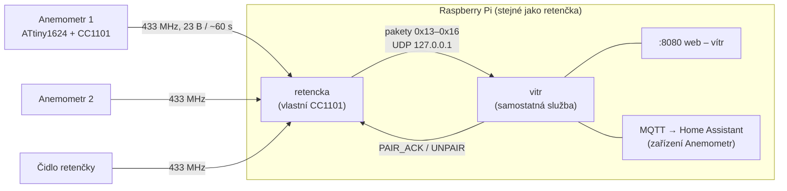

# 🌬️ Anemometr – bezdrátové měření větru

Bateriové čidlo s anemometrem LaskaKit (jazýčkový kontakt) na **desce čidla retenční nádrže**
(ATtiny1624 + CC1101, 433 MHz, AES-128). Čidlo celou dobu spí a jen počítá pulzy; jednou za
minutu pošle **počet pulzů, nejsilnější 3s náraz** a baterii. Rychlost v km/h počítá hub.



## Stav

| Část | Stav |
|---|---|
| [`uzel/`](uzel/) firmware čidla | hotový, přeložený (`uzel/build/firmware.hex`, 10,4 kB), logika čítání otestovaná (`make test`); na desce zatím nevyzkoušený |
| [`server/`](server/) služba `vitr` | hotová: párování, data, web :8080 ve stylu retenčky, MQTT do HA; testy `python -m unittest discover -s server/tests` |
| most v retenčce | větev `anemometr-most` repozitáře retenčky, testy prošly |
| [`docs/instalace.md`](docs/instalace.md) | postup instalace na Pi |
| [`docs/deska.md`](docs/deska.md) | úprava osazení desky, zapojení RJ11, spotřeba |

## Jak čidlo měří

- Kontakt je na PA6 (bývalý vstup sondy) s **interním pull-upem**; R1 100 k ani C1 10 pF
  z adaptéru LaskaKit nejsou potřeba (C10 22 nF na desce filtruje zákmity).
- Každá hrana probudí čip na pár µs, pulz se započítá (odrušení 3 ms). Jednou za sekundu
  (RTC PIT) se uzavře sekunda: součet okna a **náraz = max. pulzů za 3 s** (meteorologický standard).
- **Okno ~60 s** (náhodně 52–67 s, skutečná délka je v paketu) → odeslání → hned další okno,
  nic se neztratí. Náhodná délka + listen-before-talk + vlastní ID z výrobního čísla čipu
  zajistí, že se dva anemometry a retenčka nebudou trvale srážet.
- Rotor zastavený se sepnutým kontaktem: pull-up se vypne (jinak ~95 µA), kontrola každé 2 s.
- Baterie 1× za hodinu (i pod zátěží při vysílání), teplota čipu v každém paketu (mrazová
  pojistka vypnutí na konci životnosti baterie, jako u retenčky).

### Paket (šifrovaná část, 12 B, `<BHHHBbBBB`)

| Pole | Typ | Význam |
|---|---|---|
| flags | u8 | BAT_ERR, TEMP_ERR, STUCK, OVERFLOW, BAT_LOW, BOOT, WDT_RESET, PARTIAL |
| vbat_mv | u16 | baterie v klidu [mV] |
| pulses | u16 | pulzů v okně |
| gust_pulses | u16 | max. pulzů za 3 s v okně |
| window_s | u8 | délka okna [s] podle hodin čidla |
| temp_c | i8 | teplota čipu [°C] (−128 = neznámá) |
| fw, diag, vbat_sag | u8 | verze, diagnostika, pokles baterie při TX |

Typy paketů **0x13–0x16** (retenčka 0x03–0x06) a jiné odvození klíčů (`ANM-…`) – hub retenčky
pakety anemometru ignoruje a anemometr nikdy nepřijme párování od retenčky.

## Hub

- **retencka** dál jediná ovládá CC1101. Rámce s typem 0x13–0x16 přepošle na
  `127.0.0.1` (UDP) službě **vitr** a pošle do rádia, co jí vitr vrátí (PAIR_ACK/UNPAIR musí
  odejít do 0,6 s – lokální UDP stačí).
- **vitr** – samostatná služba (Python, jen stdlib jako retenčka): párování X25519, dešifrování,
  SQLite, web na **:8080** s uživatelskými účty jako retenčka (role, relace, CSRF, omezení pokusů, audit), MQTT Discovery do stejného Mosquitta (v HA se objeví zařízení
  „Anemometr 1/2“ – žádný další port pro HA).
- Rychlost = `otáčky/s × kalibrace`, otáčky/s = `pulses / window_s / pulzů na otáčku`; kalibrace se zadává na webu jako „1 otáčka za sekundu = X m/s“ (výchozí 0,667 m/s = 2,4 km/h);
  hub opraví nepřesnost RC hodin čidla (±3 %) podle skutečných časů příjmu paketů.

## Instalace

Na Raspberry Pi s retenčkou (s mostem z větve `anemometr-most`), podrobně v
[docs/instalace.md](docs/instalace.md):

```bash
git clone https://github.com/Svaty10/Anemometr.git ~/Anemometr && cd ~/Anemometr && sudo bash system/install.sh
```

Web anemometrů pak běží na `http://<pi>:8080` (retenčka dál na portu 80). **Uživatelské účty
jako u retenčky**: první přihlášení `admin` + kód z instalace → vlastní účet administrátora,
další uživatelé s rolí administrátor / uživatel (jen čtení), historie událostí. Bez přihlášení
web neukáže nic, takže ho lze vystavit přes Cloudflare Tunnel – viz
[docs/instalace.md](docs/instalace.md#5-přístup-zvenku-přes-cloudflare-tunnel).

## Licence

[GNU AGPL-3.0](LICENSE), stejně jako [Retenční nádrž](https://github.com/Svaty10/Retencni_Nadrz_V2).
